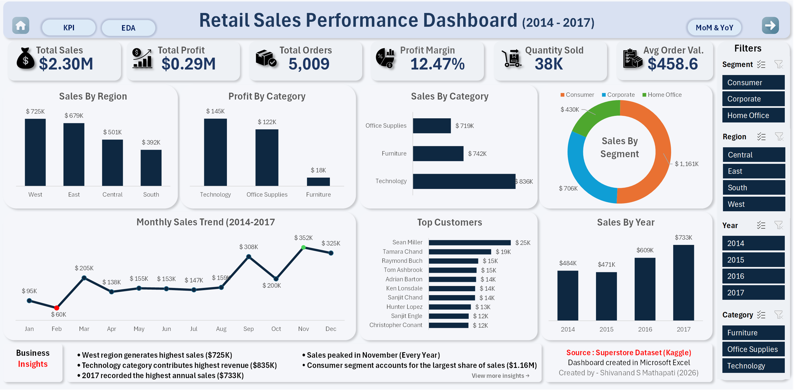
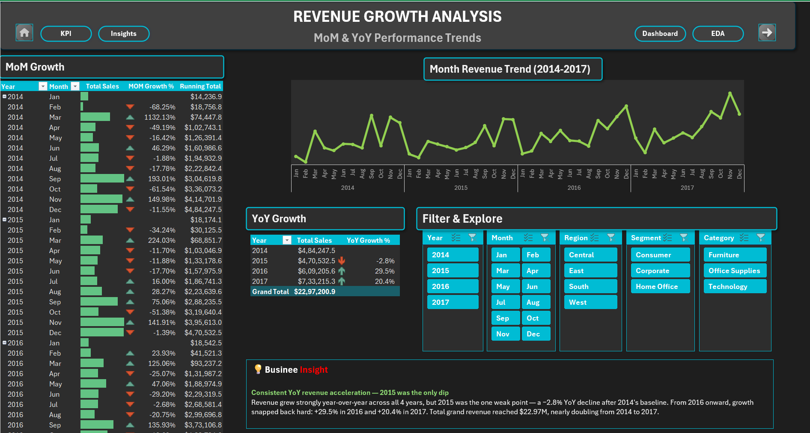
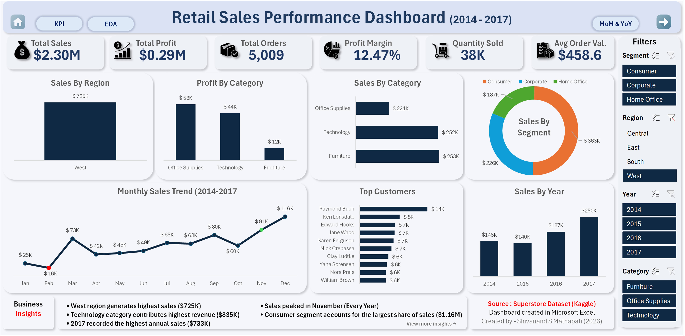
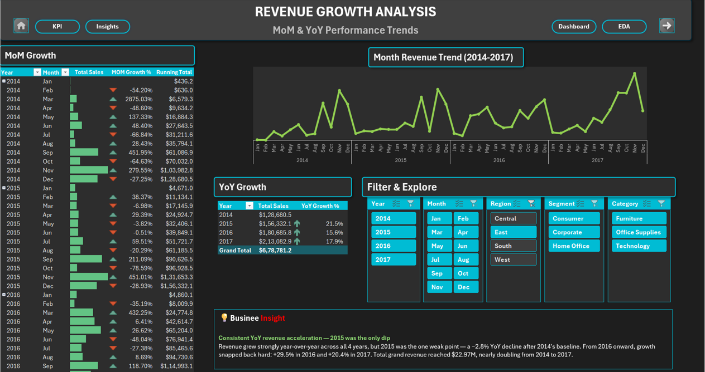
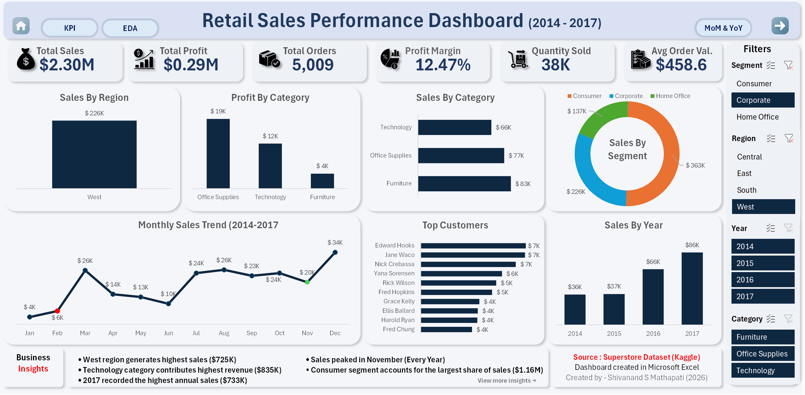

# 📊 Superstore Sales Performance Analysis — Excel Dashboard

### End-to-end retail sales dashboard built with Advanced Pivot Tables on the Sample Superstore dataset


[](#)
[](#)
[](#)
[](#)
[](#)

---

## 🗂️ Table of Contents

- [Business Impact](#-business-impact)
- [Key Highlights](#-key-highlights)
- [Project Overview](#-project-overview)
- [Business Problem](#-business-problem)
- [Dataset](#-dataset)
- [Tools & Techniques](#️-tools--techniques)
- [Project Workflow](#-project-workflow)
- [Skills Demonstrated](#️-skills-demonstrated)
- [Key KPIs](#-key-performance-indicators)
- [Key Findings & Insights](#-key-findings--insights)
- [Dashboard Preview](#-dashboard-preview)
- [Business Recommendations](#-business-recommendations)
- [Excel Formulas Used](#-excel-formulas-used)
- [File Structure](#-file-structure)
- [How to Use](#-how-to-use)
- [Connect With Me](#-connect-with-me)

---

## 🚀 Business Impact

- Identified top-performing regions contributing over **60% of total revenue**
- Detected loss-making sub-categories, enabling **profit optimization opportunities**
- Revealed seasonal demand trends to improve **inventory and marketing planning**
- Quantified discount impact leading to **better pricing strategies**

---

## 🧠 Key Highlights

- 📊 Analyzed **9,994 retail transactions** (2014–2017)
- 💰 Generated insights on **$2.29M revenue & $286K profit**
- 📈 Built **MoM & YoY growth analysis**(mini dashboard)
- 🧠 Created **12+ business KPIs**
- 📊 Designed an **interactive Excel dashboard with slicers**
- 💡 Delivered **actionable business recommendations**

---

## 🏡 Project Overview

This project performs a comprehensive **Retail Sales Performance Analysis** on a U.S. superstore dataset spanning **2014–2017**. The goal is to uncover revenue drivers, profitability gaps, seasonal trends, and customer behavior patterns — and present them through a dynamic, executive-ready Excel dashboard.

| Metric | Value |
|---|---|
| 📅 Period | 2014 – 2017 |
| 🧾 Total Orders | 5,009 |
| 👥 Total Customers | 793 |
| 📦 Total Records | 9994 rows |
| 💰 Total Revenue | $2,297,200 |
| 📈 Total Profit | $286,397 |
| 📊 Profit Margin | 12.47% |

---

## 💼 Business Problem

The management team needed a centralized dashboard to quickly understand:

- 🗺️ **Which regions generate the most sales?**
- 🛒 **Which products are most profitable?**
- 🏷️ **How do discounts affect profitability?**
- 👤 **Which customer segments contribute the most revenue?**
- 📅 **What are the sales trends over time (MoM & YoY)?**

The goal was to provide **data-driven insights** that support strategic decision-making and improve overall profitability.

---

## 📦 Dataset

**Source:** Superstore Sales Dataset (Kaggle)

The dataset contains sales transactions from a U.S. retail company. Each row represents an individual order transaction.

| Column | Description |
|---|---|
| Order ID | Unique identifier for each order |
| Order Date | Date when the order was placed |
| Ship Date | Date when the order was shipped |
| Ship Mode | Shipping method used |
| Customer ID | Unique customer identifier |
| Customer Name | Name of the customer |
| Segment | Customer type (Consumer / Corporate / Home Office) |
| Region | Geographic sales region |
| Category | Product category (Technology / Furniture / Office Supplies) |
| Sub-Category | Detailed product sub-category |
| Sales | Total sales amount ($) |
| Quantity | Number of items sold |
| Discount | Discount percentage applied |
| Profit | Profit amount ($) |

---

## 🛠️ Tools & Techniques

| Tool / Technique | Purpose |
|---|---|
| **Microsoft Excel** | Primary tool for the entire project |
| **Pivot Tables** | Data aggregation and summarization |
| **Pivot Charts** | Interactive visual representation |
| **Conditional Formatting** | KPI highlighting and data validation |
| **Data Cleaning Techniques** | Handling inconsistencies, extracting features |
| **Excel Formulas** | KPI calculation, time analysis, text processing |
| **Structured Table References** | Dynamic, robust formula construction |

---

## 🔄 Project Workflow

```
Raw Data  →  Data Cleaning  →  EDA  →  KPI Calculation  →  Time Analysis  →  Dashboard  →  Business Insights
```

---

## 🛠️ Skills Demonstrated

**1. 🧹 Data Cleaning & Preparation**
- Removed leading/trailing whitespace from customer names using `TRIM()`
- Extracted `Order_Year` and `Order_Month` from date fields using `YEAR()` and `TEXT()`
- Calculated `Profit_Margin` as Profit ÷ Sales
- Calculated `Shipping_Days` as Ship Date − Order Date
- Standardized and validated all date columns
- Final cleaned dataset: 9,994 rows × 26 columns

**2. 🔍 Exploratory Data Analysis (EDA)**
- Sales breakdown by Region, Category, Sub-Category, Customer Segment
- Top 10 States and Top 10 Customers by Sales
- Identification of loss-making products
- Profit analysis across all categories and sub-categories
- Shipping mode performance analysis (sales, profit, delivery time)

**3. 🎯 KPI Metrics Calculation**
- Total Revenue, Total Profit, Profit Margin %
- Average Order Value, Revenue per Customer, Orders per Customer
- Customer Lifetime Value, Total Customers, Total Quantity Sold
- Discount Amount, Average Discount Rate, Revenue Loss to Discount

**4. ⏰ Time Series Analysis (MoM & YoY)**
- Month-over-Month (MoM) sales growth with running totals
- Year-over-Year (YoY) growth comparison (2014–2017)
- Seasonal sales pattern identification with interactive line chart

**5. 📊 Dashboard Creation**
- Interactive, executive-ready Excel dashboard
- Slicers for dynamic filtering by region, category, and segment
- Pivot charts: bar charts, line charts, pie charts

**6. 💡 Business Insights & Recommendations**
- 13 actionable business insights derived from analysis
- Strategic recommendations for each identified pattern

---

## 📊 Key Performance Indicators

| KPI | Value |
|---|---|
| 💰 Total Revenue | $2,297,200 |
| 📈 Total Profit | $286,397 |
| 📊 Profit Margin | 12.47% |
| 🧾 Total Orders | 5,009 |
| 👥 Total Customers | 793 |
| 🛒 Average Order Value | $458.61 |
| 👤 Revenue per Customer | $2,896.85 |
| 📦 Total Quantity Sold | 37,873 |
| 🏷️ Average Discount Rate | 14.04% |
| 💸 Revenue Lost to Discounts | $322,582 |
| 📅 Avg Orders per Customer | 6.32 |
| 📦 Avg Items per Order | 7.56 |

---

## 📈 Key Findings & Insights 

### 🗺️ Regional Performance
| Region | Total Sales |
|---|---|
| West | $725,458 (31.6%) |
| East | $678,781 (29.5%) |
| Central | $501,240 (21.8%) |
| South | $391,722 (17.1%) |

- **West** region dominates sales (~$725K), contributing the highest share among all regions.
- **South** region underperforms (~$392K), indicating potential market expansion opportunity. 

### 🛒 Category Performance
| Category | Sales | Profit |
|---|---|---|
| Technology | $836,154 | $145,455 |
| Furniture | $741,999 | $18,451 |
| Office Supplies | $719,047 | $122,491 |

- **Technology** leads both **sales (~$836K) and profit (~$145K)** → highest value-generating category.
- **Furniture** generates strong revenue but low profit (~$18K) → margin issue category.

### 👤 Customer Segments
| Segment | Sales |
|---|---|
| Consumer | $1,161,401 (50.5%) |
| Corporate | $706,146 (30.7%) |
| Home Office | $429,653 (18.7%) |

- **Consumer segment** dominates (~$1.16M), contributing more than 50% of total sales.
- **Home Office segment is the weakest** (~$429K) → potential growth segment.


### 📅 Year-over-Year Growth
| Year | Revenue | YoY Growth |
|---|---|---|
| 2014 | $484,247 | — |
| 2015 | $470,533 | -2.83% |
| 2016 | $609,206 | +29.47% |
| 2017 | $733,215 | +20.36% |

- **2017** is the best-performing year (~$733K) with strong YoY growth (~20.4%).
- **2015** shows a slight decline (-2.83%), followed by strong recovery in 2016 (+29.5%).

### ❌ Loss-Making Sub-Categories
| Sub-Category | Loss |
|---|---|
| Tables | -$17,725 |
| Bookcases | -$3,473 |
| Supplies | -$1,189 |

- Tables, Bookcases, and Supplies are **loss-making** sub-categories
- **Tables alone contributing ~-$18K loss** → requires pricing or cost optimization

### 🚛 Shipping Mode
| Ship Mode | Total Sales |
|---|---|
| Standard Class| $13,58,216 |
| Second Class | $4,59,194 |
| First Class | $3,51,428 |
| Same Day | $1,28,363 |

- **Standard Class** drives the majority of sales (~$1.35M) and profit (~$164K).
- **Same Day** shipping has lowest sales (~$128K) despite fastest delivery → limited usage or higher cost.

---

## 📸 Dashboard Preview

> 📂 Open the `.xlsx` file and navigate to the **📊 Sales_Performance_Dashboard** sheet to interact with the full dashboard including slicers and dynamic charts.  
> 📌 The dashboard provides an interactive, executive-level view of retail sales performance.  
> Use slicers to dynamically filter data by Region, Category, Segment, and Year.


### 🔹 Full Dashboard View


### 🔹 Revenue Trend (MoM & YoY Analysis)


### 🔹 Region Performance


### 🔹 Region Revenue Growth Analysis


### 🔹 Customer Segment Analysis



---

## 💡 Business Recommendations

| Key Finding | Recommendation |
|---|---|
| West region dominates sales | Increase marketing & inventory in West to maximize revenue |
| South region underperforms | Launch targeted campaigns to capture untapped demand |
| Technology drives revenue | Expand product line & promote bundles |
| Furniture has low margins | Review pricing, supplier costs & logistics strategy |
| Q4 seasonal spike | Pre-load inventory and campaigns before Nov–Dec |
| Early year sales dip | Introduce clearance sales in Jan–Feb |
| Tables/Bookcases at a loss | Audit discount policies and optimize supply chain |
| Consumer segment dominates | Invest in loyalty programs and personalized offers |
| High discount impact | Cap discounts on low-margin products |
| Standard Class is #1 shipping | Optimize logistics cost for highest-volume mode |

---

## 📐 Excel Formulas Used

### 🧹 Data Cleaning (Cleaned_Data Sheet)

```excel
# Clean customer names
=TRIM(sales_data[Customer Name])

# Extract order year
=YEAR(sales_data[Order Date])

# Extract order month (abbreviated)
=TEXT(sales_data[Order Date],"mmm")

# Calculate profit margin(Column)
=sales_data[Profit] / sales_data[Sales]

# Calculate shipping days
=sales_data[Ship Date] - sales_data[Order Date]
```

### 🎯 KPI Calculations (KPI Metrics Sheet)

```excel
# Total Revenue
=SUM(sales_data[Sales])

# Total Profit
=SUM(sales_data[Profit])

# Overall Profit Margin
=SUM(sales_data[Profit]) / SUM(sales_data[Sales])

# Total Quantity Sold
=SUM(sales_data[Quantity])

# Discount Amount (Revenue × Discount Rate)
=SUMPRODUCT(sales_data[Sales], sales_data[Discount])

# Weighted Average Discount Rate
=SUMPRODUCT(sales_data[Discount], sales_data[Sales]) / SUM(sales_data[Sales])

# Revenue Loss to Discount %
=1 - (Revenue_After_Discount / Total_Revenue)

# Discount % of Revenue
=SUMPRODUCT(sales_data[Sales], sales_data[Discount]) / SUM(sales_data[Sales])
```

### 📊 EDA — Dynamic Growth Indicators

```excel
# YoY Growth with arrow indicator (positive)
=IFERROR(IF(growth_rate>0, "▲ "&TEXT(growth_rate,"0.0%"), "▼ "&TEXT(growth_rate,"0.0%")), 0)

# Positive growth display only
=IFERROR(IF(growth_rate>0, "▲ "&TEXT(growth_rate,"0.0%"), ""), 0)

# Negative growth display only
=IFERROR(IF(growth_rate<0, "▼  "&TEXT(growth_rate,"0.0%"), ""), 0)
```

---

## 📁 File Structure

```
📁 Retail-Sales-Performance-Analysis/
│
├── 📊 Retail_Sales_Performance_Analysis_Dashboard_Excel.xlsx
│   ├── 🏠 Project Overview          ← Project summary, dataset info, tools
│   ├── 📋 Raw_Data                  ← Original unmodified dataset (~10K rows)
│   ├── 🧹 Cleaned_Data              ← Processed data with 5 engineered features
│   ├── 🔍 EDA                       ← Exploratory analysis & pivot summaries
│   ├── 🎯 KPI Metrics               ← 12 calculated business KPIs
│   ├── ⏰ Time_Analysis (MoM & YoY) ← Monthly & yearly trend analysis
│   ├── 📊 Sales_Performance_Dashboard ← Interactive executive dashboard
│   └── 💡 Business_Insights_&_Actions ← Most valuable strategic recommendations
│
└── 📄 README.md
```

---

## 🚀 How to Use

1. **Download** the `.xlsx` file from this repository
2. **Open** it in Microsoft Excel (2016 or later recommended)
3. **Start** with the `🏠 Project Overview` sheet for context
4. **Explore** `🔍 EDA` and `🎯 KPI Metrics` for data insights
5. **Interact** with the `📊 Sales_Performance_Dashboard` using slicers
6. **Review** `💡 Business_Insights_&_Actions` for strategic takeaways

> ⚠️ **Note:** For the best experience with slicers and pivot charts, open with Microsoft Excel (not Google Sheets or LibreOffice).

---

## 🤝 Connect With Me

Feel free to reach out for opportunities, feedback or collaboration!

- 🔗 **LinkedIn:** 
- 💻 **GitHub:** https://github.com/shivanand-Mathapati-Analyst
- 📧 **Email:** shivanandmathapati350@gmail.com

---

*⭐ If you found this project helpful, please consider giving it a it a star!*

---

### 🚀 Built with ❤️ using Excel, Pivot Tables & Data Analytics

---
> **Tags:** `#DataAnalytics` `#Excel` `#RetailAnalysis` `#Dashboard` `#KPI` `#DataVisualization` `#PortfolioProject`
